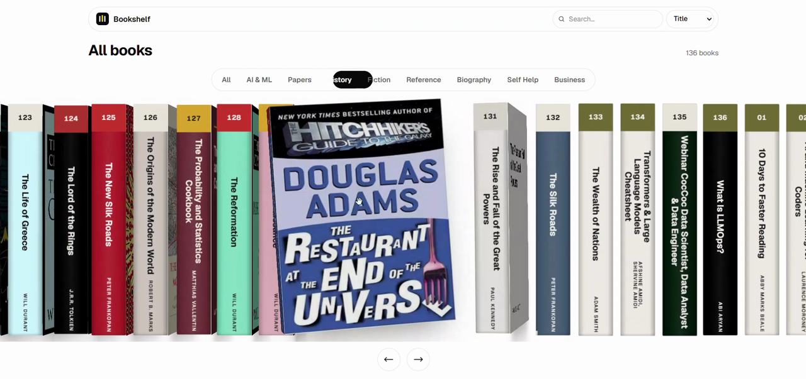

# Bookshelf

A 3D bookshelf for your own PDF library. Scroll along a shelf of CSS-3D spines, hover to see a
cover, click to open the book page, and read it in the browser with highlights and notes.

[](docs/demo.mp4)

▶ [Watch the demo (1 min)](docs/demo.mp4) · Live: [readwithabhijit.vercel.app](https://readwithabhijit.vercel.app)
(you can browse the shelf; opening the books needs the owner's Google sign-in)

Plain HTML, CSS and JavaScript. No framework, no build step, no npm dependencies.

## Features

- **3D shelf.** One continuous, looping shelf. The book passing the centre turns to face you,
  and wheel, drag, touch and arrow keys all work. Each folder becomes a tab, and you can search
  by title or author.
- **Book page.** Click the centre cover and the book page grows out of it, with its own link
  (`#<path>`).
- **Reader.** PDF.js with page and text modes, margin crop, a contents panel, and highlights in
  four colours with notes.
- **Covers.** Rendered from each PDF's first page. Titles and authors come from Open Library.
- **Hosting (optional).** Put the shelf on Vercel and read the PDFs from Cloudflare R2 or
  Google Drive, locked to your own Google account. Highlights sync between devices through
  Drive.

## Quick start (local)

Needs [Node.js](https://nodejs.org) 18+ and, for covers, Python 3 with PyMuPDF (`pip install pymupdf`).

```sh
git clone https://github.com/abhijitdalal26/bookshelf.git
cd bookshelf
cp shelf.config.example.json shelf.config.json   # then set booksDir (see below)

node scripts/scan-books.js      # scan your books → app/books.js
python scripts/make-covers.py   # render covers  → app/covers/, app/covers.js
node scripts/build-about.js     # optional notes → app/about.js
node scripts/serve.js           # http://localhost:8931
```

Run the scan and the covers again whenever you add, move or remove books.

## Your books

Point `booksDir` at a folder of PDFs (default: `books/` in this repo). Top-level folders become
tabs and subfolders become `Parent / Child` tabs:

```
books/
  Fiction/
    The Hobbit.pdf
  Science/
    Physics/
      Six Easy Pieces.pdf
```

Your books, the generated files (`books.js`, `covers/`, `about.js`) and your highlights
(`data/notes.json`) are git-ignored, so none of them end up in your repo.

## Configuration

`shelf.config.json` (git-ignored) holds the local settings. Leave a field out to use its default.

| Field       | Default       | What it does |
|-------------|---------------|--------------|
| `booksDir`  | `"books"`     | Folder with your PDFs. Absolute, or relative to the repo. |
| `port`      | `8931`        | Port for the local server. |
| `driveDir`  | `""`          | Optional folder to mirror your books into, e.g. `"G:/My Drive/Books"` with Google Drive for desktop. Adds a **Sync Drive** button. Windows only (uses robocopy), and it only adds or updates files, never deletes. |
| `driveSkip` | `[]`          | Folder names the mirror leaves out. |
| `r2Bucket`  | `"bookshelf"` | Cloudflare R2 bucket used by `scripts/upload-r2.js`. |

If a book gets the wrong title or author, add the file name to `OVERRIDES` in
`scripts/scan-books.js`. The entries there are for the original owner's library and do nothing
for files you don't have.

### Notes about each book (optional)

Write `data/about-<anything>.json` files with entries like this, then run `node scripts/build-about.js`:

```json
[{ "path": "D:/Books/Fiction/The Hobbit.pdf", "about": "…", "kind": "Novel", "level": "Beginner",
   "topics": ["fantasy"], "readIf": "…", "takeaway": "…" }]
```

`path` must match the book's `path` in `app/books.js`. The `about-*.json` files in this repo are
the original owner's, so delete them or replace them with your own.

## Hosting it (optional)

The local server does everything. Hosting puts only the shelf (titles, covers, notes) on a public
site. The PDFs stay private, and only your own Google account can open them.

1. **Google sign-in.** In Google Cloud Console, enable the Drive API and create an OAuth
   *Web client*. Add your site's address (e.g. `https://yourshelf.vercel.app`) as both an
   authorised JavaScript origin and a redirect URI (with a trailing `/`). Put the client ID in
   `app/config.js`.
2. **Drive.** Upload your books folder to `My Drive/Books` (or set `driveFolder` in
   `app/config.js`). This is the fallback source, and the app-data folder stores your synced
   highlights.
3. **Faster reading with R2 (optional).** Create an R2 bucket, then in `worker/wrangler.toml`
   set `bucket_name`, `GOOGLE_CLIENT_ID`, `OWNER_EMAIL` (your Google account) and
   `ALLOWED_ORIGINS` (your site). Then:
   ```sh
   cd worker
   npx wrangler secret put SIGNING_KEY   # any long random string
   npx wrangler deploy
   cd .. && node scripts/upload-r2.js    # uploads new/changed PDFs
   ```
   Put the Worker's address in `filesUrl` in `app/config.js`. Leave it empty to read from Drive only.
4. **Deploy.** `cd app && vercel deploy --prod`. This deploys the local folder, generated files
   included, so deploy again after each rescan. `app/vercel.json` marks the site `noindex`.

## Project layout

```
app/          the site: index.html, shelf.css, shelf.js (shelf), reader.js (PDF reader),
              notes.js (highlights), drive.js (book source: local / R2 / Drive), config.js
scripts/      scan-books.js, make-covers.py, build-about.js, serve.js, upload-r2.js, config.js
worker/       Cloudflare Worker that serves PDFs from R2 to the owner's Google token only
data/         per-book notes (about-*.json); notes.json and r2-manifest.json are local only
docs/         screenshot and demo video
```

## Credits

The interaction is inspired by the bookshelf on
[layoffsandhires.com/engineering](https://layoffsandhires.com/engineering). PDFs are rendered with
[PDF.js](https://mozilla.github.io/pdf.js/), and book data comes from
[Open Library](https://openlibrary.org).
